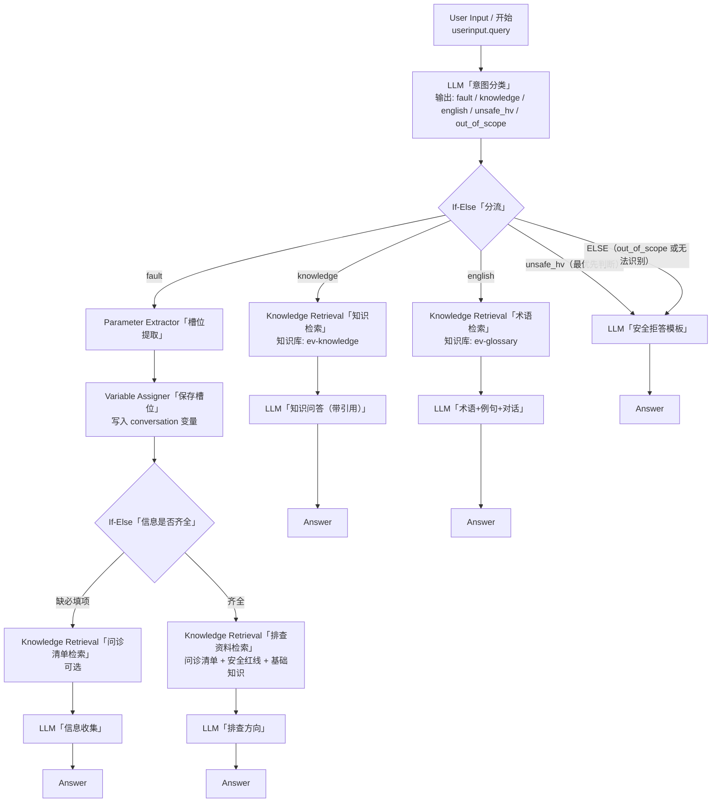

# 架构总览（Architecture）

> 状态：**设计稿**。本 Chatflow 尚未在 Dify 中搭建或运行。节点名称参考 Dify 官方文档（2026-10-26 查阅）。

## 1. 应用类型

- Dify 应用类型：**Chatflow**（带对话层；每条用户消息触发一次流程；必须以 **Answer** 节点结束）
- 应用名：`EV`
- 起点：**User Input** 节点（中文界面可能显示为「用户输入」/「开始」）。用户本轮消息在官方文档中写作 `userinput.query`（旧版本界面/社区资料中常见 `sys.query`，以实际界面变量选择器为准）

## 2. 流程图

## 3. 设计要点

| 要点 | 说明 |
|------|------|
| 分类方式 | 按需求使用 **LLM 节点**做意图分类，输出单个标签，再用 **If-Else** 分支。**备选方案**：Dify 自带 **Question Classifier** 节点（直接定义 5 个 class，每个 class 自带一条输出路径，可省掉 If-Else）。两种方式的取舍见 `workflow-nodes.md` §3 |
| 分支优先级 | If-Else 先判断 `unsafe_hv`，确保危险高压请求不会被误路由到排查分支 |
| 多轮记忆 | 故障槽位（品牌、车型、年款、里程、能否上电等）存在 **conversation variables**（会话变量），整个会话内持续有效；由 **Parameter Extractor + Variable Assigner** 更新 |
| 引用来源 | 知识问答分支的 LLM 节点把 Knowledge Retrieval 的 `result` 设为 **Context**；Chatflow 默认在回答旁显示引用（Features 中的 Citation and Attributions） |
| 不知道就说不知道 | 检索结果为空或不相关时，提示词要求明确回答「知识库中没有找到可靠依据」 |
| 安全拒答 | `unsafe_hv` 和 `out_of_scope` 共用一个 LLM「安全拒答模板」节点，提示词中按意图标签选择话术 |
| 品牌 | 示例覆盖 Tesla、GAC Aion、BYD、Toyota、Nissan、Honda、VW ID.、BMW i、Mercedes EQ；只给一般性信息和「去哪查官方资料」，不编造 DTC/规格/步骤 |

## 4. 知识库规划

| 知识库（Knowledge）名称 | 包含文件 | 被哪些节点使用 |
|------|------|------|
| `ev-knowledge` | 01-fault-intake.md、02-ev-basics.md、03-safety-hv.md、05-australia-notes.md | 知识检索、问诊清单检索、排查资料检索 |
| `ev-glossary` | 04-glossary-en.md | 术语检索 |

> 也可以只建一个知识库放全部 5 个文件，用 metadata 过滤区分（Dify 文档支持 metadata filtering）。分两个库对新手更直观。
> 注意（来自 Dify 社区讨论，未本地验证）：同一个 Knowledge Retrieval 节点挂多个知识库时，若索引方式/embedding 模型不同又未配置 rerank，可能检索失败。建议两个库用相同索引设置。

## 5. 不在本版本范围内

- 图片识别（如拍仪表盘照片）——以后可开启 Vision，本版不设计
- 外部工具 / HTTP 调用（如查询官方召回数据库）——本版不设计
- 任何真实车厂数据接入
